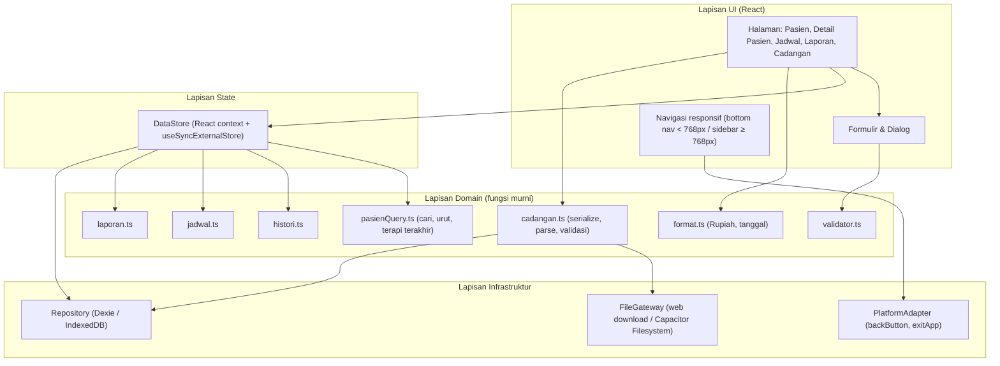
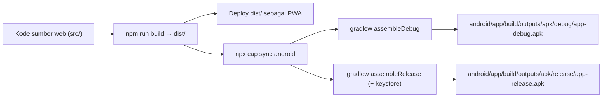

# Design Document: Manajemen Pasien Terapi

## Overview

Aplikasi Manajemen Pasien Terapi dibangun sebagai Progressive Web App (PWA) satu halaman (SPA) yang berjalan sepenuhnya di sisi klien (offline-first) dan menyimpan seluruh data secara lokal di IndexedDB. Kode sumber web yang sama dikemas menjadi APK_Android menggunakan Capacitor, sehingga hanya ada satu basis kode.

Keputusan utama:

| Keputusan | Pilihan | Alasan |
|---|---|---|
| Bahasa & framework UI | TypeScript + React 18 + Vite | Tipe statis untuk model data, ekosistem luas, build cepat |
| Penyimpanan lokal | IndexedDB melalui Dexie.js | Transaksi atomik lintas tabel (penting untuk hapus berantai dan impor), kapasitas besar, tersedia di peramban dan WebView Android |
| Offline web | `vite-plugin-pwa` (Workbox) | Precache seluruh aset sehingga Aplikasi terbuka tanpa internet (Req 11.5), manifest untuk ikon & mode `standalone` (Req 11.4, 11.7) |
| Pengemasan Android | Capacitor 8 | Mendukung API 24+ (Android 7.0) sesuai asumsi; aset web dibundel di dalam APK sehingga berjalan offline sejak pemasangan pertama (Req 13.10) |
| Tombol kembali Android | Plugin `@capacitor/app` (`backButton` listener) | Kendali penuh atas perilaku Req 13.14–13.18 |
| Ekspor file di Android | `@capacitor/filesystem` (direktori `Documents`) | Peramban di WebView tidak mendukung unduhan `<a download>` secara andal |
| Pengujian | Vitest, fast-check, Testing Library, fake-indexeddb, Playwright | Unit + property-based test + uji responsif lintas lebar layar |

Temuan riset yang memengaruhi desain:

- Capacitor mendukung Android API 24+ (Android 7) dan membutuhkan WebView berbasis Chrome 60 ke atas ([Capacitor Android docs](https://capacitorjs.com/docs/android)). Ini cocok dengan asumsi versi minimal Android 7.0.
- Capacitor 8 memerlukan Node.js 22+ ([Capacitor 8 update guide](https://next.capacitorjs.com/docs/updating/8-0)), dengan target SDK 36, minSdk 24, JDK 21, AGP 8.13, dan Gradle 8.14 ([Capgo troubleshooting](https://capgo.app/blog/troubleshooting-capacitor-android-build-errors/)). Angka-angka ini masuk ke daftar prasyarat Dokumentasi_Build.
- Capacitor Android tidak mendukung target SDK kustom; setiap versi Capacitor terikat pada target SDK tertentu ([Setting Target SDK](https://capacitorjs.com/docs/v7/android/setting-target-sdk)). Karena itu versi Capacitor dikunci (pinned) agar build dapat diulang (Req 13.4).

Content was rephrased for compliance with licensing restrictions.

Prinsip desain:

1. **Logika murni terpisah dari I/O.** Validasi, format, pencarian, pengurutan, histori, laporan, dan serialisasi cadangan adalah fungsi murni tanpa akses DOM atau IndexedDB. Ini membuat logika inti dapat diuji dengan property-based testing.
2. **Tulis dulu, tampilkan kemudian.** Pesan berhasil hanya ditampilkan setelah transaksi IndexedDB selesai (`transaction.complete`), sesuai Req 10.1.
3. **Atomik atau tidak sama sekali.** Setiap operasi tulis yang menyentuh lebih dari satu rekaman (hapus pasien berantai, impor) dijalankan dalam satu transaksi Dexie `rw` sehingga kegagalan membatalkan seluruh perubahan (Req 3.6, 10.5, 14.7).
4. **Tanggal sebagai teks kalender.** Tanggal disimpan sebagai `"YYYY-MM-DD"` dan jam sebagai `"HH:mm"` (waktu lokal), menghindari pergeseran zona waktu.

## Architecture



### Alur data

1. Saat Aplikasi dibuka, `DataStore.load()` membaca ketiga tabel dari IndexedDB ke memori. Jika gagal, state menjadi `{ status: 'error' }` dan UI menampilkan "Data gagal dimuat" tanpa menulis apa pun (Req 10.6). Basis data kosong menghasilkan state kosong tanpa error (Req 10.7).
2. Operasi tulis: UI → Validator → `Repository` (transaksi) → jika sukses, `DataStore` memperbarui salinan memori dan memberi tahu pelanggan (re-render tanpa memuat ulang halaman, Req 1.1, 7.7) → UI menampilkan pesan berhasil. Jika gagal, memori tidak diubah dan formulir tetap terisi (Req 10.4).
3. Tampilan turunan (daftar pasien terurut, histori, jadwal per tanggal, laporan) dihitung dari salinan memori melalui fungsi domain murni dan di-memoize.

### Alur build



Skrip `scripts/build-android.mjs` menjalankan langkah-langkah di atas berurutan: (1) cek prasyarat (versi Node, JDK, Android SDK), (2) `vite build`, (3) `cap sync android`, (4) Gradle assemble, (5) salin APK ke `release/`. Setiap langkah dibungkus sehingga kegagalan mencetak `Langkah gagal: <nama langkah>`, keluar dengan kode non-nol, dan menghapus berkas APK sementara sebelum disalin ke lokasi keluaran (Req 13.5). APK hanya dipindahkan ke lokasi keluaran setelah seluruh langkah berhasil.

### Struktur direktori

```
src/
  domain/        validator.ts, format.ts, pasienQuery.ts, histori.ts, jadwal.ts,
                 laporan.ts, cadangan.ts, ids.ts, tanggal.ts, types.ts
  infra/         db.ts (Dexie), repository.ts, fileGateway.ts, platform.ts
  state/         dataStore.ts
  ui/            pages/, components/, dialogs/, navigation/
  main.tsx
android/         proyek Capacitor (dihasilkan, dikomit)
scripts/         build-android.mjs, check-prereq.mjs
docs/BUILD.md    Dokumentasi_Build
version.json     { "versionName": "1.0.0", "versionCode": 1 }
```

## Components and Interfaces

### 1. Validator (`domain/validator.ts`)

Fungsi murni yang menerima input mentah formulir dan mengembalikan hasil berupa data ternormalisasi atau kumpulan kesalahan per field. Semua kesalahan dikumpulkan sekaligus (Req 1.8, 5.9).

```ts
type FieldErrors<K extends string> = Partial<Record<K, string>>;
type ValidationResult<T, K extends string> =
  | { ok: true; value: T }
  | { ok: false; errors: FieldErrors<K> };

function validatePasien(input: PasienInput): ValidationResult<PasienFields, 'nama' | 'alamat' | 'noHp'>;
function validateSesi(input: SesiInput): ValidationResult<SesiFields, 'tanggal' | 'keluhan' | 'polaPenyakit' | 'terapi' | 'hasil' | 'biaya'>;
function validateJadwal(input: JadwalInput, now: Date, pasienIds: Set<string>): ValidationResult<JadwalFields, 'pasienId' | 'tanggal' | 'jam' | 'catatan'>;
function isNomorHpValid(s: string): boolean;
function isTanggalValid(s: string): boolean; // "YYYY-MM-DD" dan tanggal kalender nyata
```

Aturan:

| Field | Normalisasi | Aturan | Pesan |
|---|---|---|---|
| nama | `trim()` | wajib, 1–100 karakter | "Nama wajib diisi" / "Nama maksimal 100 karakter" |
| alamat | `trim()` | ≤ 255 karakter (boleh kosong) | "Alamat maksimal 255 karakter" |
| noHp | `trim()` | Nomor_HP_Valid | "Nomor HP tidak valid" |
| tanggal terapi | — | wajib, tanggal kalender valid | "Tanggal terapi wajib diisi" |
| keluhan, terapi | `trim()` | wajib, ≤ 1000 | "Keluhan wajib diisi" / "Terapi yang diberikan wajib diisi" / "… melebihi batas 1000 karakter" |
| polaPenyakit, hasil | `trim()` | opsional, ≤ 1000 | "… melebihi batas 1000 karakter" |
| biaya | `trim()` input teks | `/^\d+$/`, 0–999.999.999 | "Biaya harus berupa angka 0 atau lebih" |
| jadwal pasienId, tanggal, jam | — | wajib; jam `/^([01]\d|2[0-3]):[0-5]\d$/` | "Pasien wajib diisi" / "Tanggal wajib diisi" / "Jam wajib diisi" |
| jadwal waktu | — | `tanggal+jam ≥ now` (presisi menit) | "Jadwal tidak boleh di waktu yang sudah lewat" |
| catatan | `trim()` | ≤ 500 | "Catatan maksimal 500 karakter" |

Panjang karakter dihitung dengan `[...s].length` (code point) agar karakter non-ASCII seperti emoji dihitung satu karakter.

Definisi Nomor_HP_Valid (diterjemahkan ke kode):

```ts
// Hanya angka dengan "+" opsional di depan; awalan 08 | 628 | +628; total digit 10–15.
function isNomorHpValid(s: string): boolean {
  if (!/^\+?\d+$/.test(s)) return false;
  if (!/^(08|628|\+628)/.test(s)) return false;
  const digits = s.replace('+', '').length;
  return digits >= 10 && digits <= 15;
}
```

### 2. Format (`domain/format.ts`)

```ts
function formatRupiah(n: number | null | undefined): string; // "Rp 150.000"; null → "-"
function parseRupiah(s: string): number;                     // kebalikan formatRupiah (untuk round-trip & uji)
function formatTanggal(iso: string | null | undefined): string; // "05 Januari 2025"; kosong/tidak valid → "-"
function formatJam(hhmm: string): string;                    // "09:30"
```

`formatRupiah` diimplementasikan manual (bukan `Intl.NumberFormat`) karena keluaran `Intl` untuk `id-ID` memakai spasi tak-putus (U+00A0) dan bisa berbeda antar versi WebView, sedangkan Req 12.1 menuntut tepat satu spasi biasa.

### 3. Query Pasien (`domain/pasienQuery.ts`)

```ts
function sortPasien(list: Pasien[]): Pasien[];              // nama menaik, case-insensitive (localeCompare 'id', sensitivity 'base'), tie-break id
function searchPasien(list: Pasien[], keyword: string): Pasien[]; // trim, lowercase, substring pada nama atau noHp; kosong → semua; hasil sudah terurut
function lastTherapyDate(pasienId: string, sesi: SesiTerapi[]): string | null;
function deletionSummary(pasienId: string, sesi: SesiTerapi[], jadwal: JadwalKunjungan[]): { jumlahSesi: number; jumlahJadwal: number };
```

UI pencarian memakai `maxLength={100}` dan debounce 200 ms (di bawah batas 500 ms Req 4.3). Pesan kosong: "Belum ada data pasien" jika tidak ada pasien sama sekali; "Pasien tidak ditemukan" jika kata kunci tidak kosong dan hasil kosong.

### 4. Histori (`domain/histori.ts`)

```ts
function buildHistori(pasienId: string, sesi: SesiTerapi[]): {
  items: SesiTerapi[];   // hanya milik pasien; urut tanggal desc, lalu createdAt desc
  jumlah: number;
  totalBiaya: number;
};
```

### 5. Jadwal (`domain/jadwal.ts`)

```ts
function jadwalPadaTanggal(tanggal: string, jadwal: JadwalKunjungan[]): JadwalKunjungan[]; // semua status, urut jam asc
function jadwalTerjadwalPasien(pasienId: string, jadwal: JadwalKunjungan[]): JadwalKunjungan[]; // status Terjadwal, urut tanggal+jam asc
function transisiStatus(j: JadwalKunjungan, target: 'Selesai' | 'Dibatalkan'): JadwalKunjungan | null; // null jika status bukan Terjadwal
function aksiTersedia(j: JadwalKunjungan): { ubah: boolean; selesai: boolean; batal: boolean; hapus: true };
```

Setelah ditandai Selesai, UI menawarkan dialog "Catat sesi terapi sekarang?". Jika ya, formulir sesi dibuka dengan `pasienId` dan `tanggal` jadwal sebagai nilai awal (Req 8.9).

### 6. Laporan (`domain/laporan.ts`)

```ts
function buildLaporan(bulan: number /*1-12*/, tahun: number, sesi: SesiTerapi[], pasien: Pasien[]): {
  total: number;
  jumlahSesi: number;
  jumlahPasien: number;           // pasienId berbeda
  rincian: Array<{ id: string; tanggal: string; namaPasien: string; terapi: string; biaya: number }>;
  // urut tanggal asc, lalu nama pasien asc (case-insensitive)
};
```

Filter memakai perbandingan prefiks `tanggal.startsWith(\`${tahun}-${pad2(bulan)}-\`)`, sehingga batas akhir bulan dan 29 Februari tertangani otomatis tanpa aritmetika tanggal. Sesi milik pasien yang sudah dihapus tidak mungkin ada karena penghapusan berantai; sebagai pertahanan tambahan, sesi tanpa pasien yang cocok diabaikan. Pilihan tahun: 2000 sampai tahun berjalan + 1.

### 7. Cadangan (`domain/cadangan.ts` + `infra/fileGateway.ts`)

```ts
const FORMAT_VERSION = 1;
function serializeBackup(data: AppData, exportedAt: Date): string;   // JSON.stringify berindentasi 2
function backupFileName(d: Date): string;                            // "datapasien-cadangan-YYYYMMDD-HHmm.json"
function parseBackup(text: string): { ok: true; data: AppData; counts: Counts } | { ok: false; reason: string };

interface FileGateway {
  saveText(fileName: string, content: string): Promise<{ location: string }>;
  pickTextFile(): Promise<string | null>; // null jika pemilihan dibatalkan (Req 14.12)
}
```

`parseBackup` memeriksa berurutan dan berhenti pada alasan pertama: file kosong → JSON tidak valid → struktur tidak sesuai → versi tidak didukung → rekaman tidak lolos Validator (aturan sama dengan formulir, kecuali aturan "jadwal tidak boleh lewat" yang tidak diterapkan saat impor karena jadwal historis sah) → identitas ganda → sesi/jadwal yang `pasienId`-nya tidak ada di file. Alasan ditampilkan dalam Bahasa Indonesia, misalnya "File bukan JSON yang valid".

Implementasi `FileGateway`:
- Web: `saveText` membuat `Blob` dan memicu unduhan; `location` = "folder Unduhan". `pickTextFile` memakai `<input type="file" accept=".json,application/json">` dan mendeteksi pembatalan melalui event `cancel`.
- Android: `saveText` memakai `Filesystem.writeFile({ directory: Directory.Documents, encoding: Utf8 })`; `location` = path yang dikembalikan. `pickTextFile` memakai input file yang sama (WebView Capacitor mendukung pemilih file sistem).

### 8. Repository (`infra/repository.ts`)

```ts
interface Repository {
  loadAll(): Promise<AppData>;
  addPasien(p: Pasien): Promise<void>;
  updatePasien(p: Pasien): Promise<void>;          // gagal dengan NotFoundError jika id tidak ada
  deletePasienCascade(id: string): Promise<void>;  // satu transaksi: pasien + sesi + jadwal
  addSesi(s: SesiTerapi): Promise<void>;
  updateSesi(s: SesiTerapi): Promise<void>;
  deleteSesi(id: string): Promise<void>;
  addJadwal(j: JadwalKunjungan): Promise<void>;
  updateJadwal(j: JadwalKunjungan): Promise<void>;
  deleteJadwal(id: string): Promise<void>;
  replaceAll(data: AppData): Promise<void>;        // satu transaksi: clear 3 tabel lalu bulkAdd
}
```

Implementasi Dexie menggunakan `db.transaction('rw', db.pasien, db.sesi, db.jadwal, async () => …)`. Dexie membatalkan seluruh transaksi bila ada promise yang ditolak di dalamnya, memenuhi kebutuhan atomik. Pada web, Aplikasi memanggil `navigator.storage.persist()` saat pertama dibuka untuk mengurangi risiko data dihapus otomatis oleh peramban.

### 9. DataStore (`state/dataStore.ts`)

Menyimpan `AppData` di memori, mengekspos selector, dan aksi asinkron yang mengikuti pola: validasi → tulis via Repository → perbarui memori → resolve. Aksi melempar `SaveError` saat Repository gagal sehingga UI dapat menampilkan "Data gagal disimpan" dan mempertahankan formulir. Karena hanya ada satu sumber data (IndexedDB lokal) dan tidak ada sinkronisasi server, status koneksi tidak memengaruhi data (Req 11.8).

### 10. UI dan Navigasi

- Rute (React Router, hash router agar kompatibel dengan `file://`/Capacitor): `/` (daftar pasien = Halaman_Utama), `/pasien/:id`, `/jadwal`, `/laporan`, `/cadangan`.
- Navigasi: `< 768px` bottom navigation bar tetap dengan tiga item (Pasien, Jadwal, Laporan) + ikon pengaturan menuju Cadangan; `≥ 768px` sidebar kiri tetap terlihat. Setiap menu tercapai dalam 1 ketukan.
- Semua elemen interaktif memiliki `min-height: 44px; min-width: 44px` melalui token CSS global; layout memakai CSS Grid/Flex dengan `max-width: 100%` dan `overflow-wrap: anywhere` untuk mencegah scroll horizontal pada 360–1920 px.
- Formulir dan dialog konfirmasi memakai komponen `Dialog` tunggal berbasis elemen `<dialog>` yang mendaftarkan diri ke `DialogStack` agar Tombol_Kembali dapat menutup dialog teratas.

### 11. PlatformAdapter (`infra/platform.ts`)

```ts
interface PlatformAdapter {
  isNative: boolean;
  onBack(handler: () => void): () => void;
  exitApp(): void;
}
```

Logika Tombol_Kembali (Android saja):

```mermaid
flowchart TD
    B[Tombol_Kembali ditekan] --> D{Ada dialog terbuka?}
    D -- Ya --> C[Tutup dialog teratas = Batal]
    D -- Tidak --> H{Di Halaman_Utama?}
    H -- Tidak --> N[navigate(-1)]
    H -- Ya --> E[Tampilkan dialog konfirmasi keluar: Keluar / Batal]
    E -- Keluar --> X[App.exitApp]
    E -- Batal --> S[Tutup dialog, tetap di Halaman_Utama]
```

Karena setiap operasi tulis sudah selesai sebelum pesan berhasil, `exitApp()` tidak memerlukan langkah flush tambahan (Req 13.17).

### 12. Konfigurasi Android dan Build

- `capacitor.config.ts`: `appId: 'com.datapasien.terapi'` (Package_Identifier tetap; dapat diganti pemilik proyek sebelum rilis pertama, lalu dikunci), `appName: 'Data Pasien'`, `webDir: 'dist'`. Aset web dibundel di dalam APK (tanpa `server.url`) sehingga tidak butuh internet.
- `android/app/build.gradle` membaca `versionCode` dan `versionName` dari `version.json` di root; `minSdkVersion 24`.
- Penandatanganan rilis: `android/keystore.properties` (tidak dikomit, masuk `.gitignore`) berisi `storeFile`, `storePassword`, `keyAlias`, `keyPassword`; alternatif variabel lingkungan `DATAPASIEN_KEYSTORE_*`. Jika tidak ada, skrip rilis gagal di langkah "Cek Kunci_Penandatanganan".
- `scripts/check-prereq.mjs` memvalidasi Node ≥ 22, JDK ≥ 21, `ANDROID_HOME` tersedia; skrip rilis juga memvalidasi bahwa `versionCode` di `version.json` lebih besar dari nilai di `release/last-release.json` dan `versionName` cocok dengan `^\d+\.\d+\.\d+$` serta berbeda (Req 13.13).
- Ikon: `@capacitor/assets` menghasilkan ikon Android dari `assets/icon.png`; manifest PWA memakai ikon yang sama.
- `docs/BUILD.md` memuat: prasyarat dan versi minimal, `npm run android:debug`, `npm run android:release`, pembuatan keystore dengan `keytool -genkey -v -keystore datapasien-release.jks -keyalg RSA -keysize 2048 -validity 10000 -alias datapasien`, saran penyimpanan cadangan keystore di luar repositori, lokasi keluaran `release/`, dan cara menaikkan versi di `version.json`.

## Data Models

```ts
// domain/types.ts
type ISODate = string; // "YYYY-MM-DD" (kalender lokal)
type HHmm = string;    // "HH:mm" (24 jam)

interface Pasien {
  id: string;          // UUID v4 (crypto.randomUUID), tidak pernah berubah
  nama: string;        // trimmed, 1–100
  alamat: string;      // trimmed, 0–255
  noHp: string;        // Nomor_HP_Valid
  createdAt: number;   // epoch ms
  updatedAt: number;
}

interface SesiTerapi {
  id: string;
  pasienId: string;    // FK → Pasien.id
  tanggal: ISODate;
  keluhan: string;     // 1–1000
  polaPenyakit: string;// 0–1000 ("" jika kosong)
  terapi: string;      // 1–1000
  hasil: string;       // 0–1000
  biaya: number;       // bilangan bulat 0–999.999.999
  createdAt: number;   // dipakai sebagai tie-break urutan histori
  updatedAt: number;
}

type StatusJadwal = 'Terjadwal' | 'Selesai' | 'Dibatalkan';

interface JadwalKunjungan {
  id: string;
  pasienId: string;
  tanggal: ISODate;
  jam: HHmm;
  catatan: string;     // 0–500
  status: StatusJadwal;
  createdAt: number;
  updatedAt: number;
}

interface AppData {
  pasien: Pasien[];
  sesi: SesiTerapi[];
  jadwal: JadwalKunjungan[];
}
```

### Skema IndexedDB (Dexie)

```ts
db.version(1).stores({
  pasien: 'id, nama',
  sesi:   'id, pasienId, tanggal',
  jadwal: 'id, pasienId, tanggal, status',
});
```

Indeks `pasienId` mempercepat hapus berantai; indeks `tanggal` mendukung laporan dan jadwal harian. Perubahan skema di masa depan memakai `db.version(n).upgrade()` sehingga pembaruan APK mempertahankan data (Req 13.12).

### Format File_Cadangan

```json
{
  "app": "datapasien",
  "formatVersion": 1,
  "exportedAt": "2025-01-05T09:30:00+07:00",
  "data": {
    "pasien": [ { "id": "…", "nama": "…", "alamat": "…", "noHp": "…", "createdAt": 0, "updatedAt": 0 } ],
    "sesi":   [ { "id": "…", "pasienId": "…", "tanggal": "2025-01-05", "keluhan": "…", "polaPenyakit": "", "terapi": "…", "hasil": "", "biaya": 150000, "createdAt": 0, "updatedAt": 0 } ],
    "jadwal": [ { "id": "…", "pasienId": "…", "tanggal": "2025-01-10", "jam": "09:30", "catatan": "", "status": "Terjadwal", "createdAt": 0, "updatedAt": 0 } ]
  }
}
```

`exportedAt` ditulis dalam ISO 8601 dengan offset zona waktu lokal perangkat. File ditulis dalam UTF-8 sehingga karakter non-ASCII terjaga.

## Correctness Properties

*A property is a characteristic or behavior that should hold true across all valid executions of a system-essentially, a formal statement about what the system should do. Properties serve as the bridge between human-readable specifications and machine-verifiable correctness guarantees.*

Properti di bawah ini menguji lapisan domain murni dan DataStore dengan Repository in-memory atau fake-indexeddb. Perilaku build/APK, tata letak responsif, dan instalasi Android tidak termasuk di sini (lihat Testing Strategy).

### Property 1: Validator pasien sesuai model aturan

*For any* input formulir pasien (nama, alamat, noHp berupa string acak termasuk spasi di tepi, whitespace saja, karakter non-ASCII, dan panjang di sekitar batas), `validatePasien` menerima input jika dan hanya jika model referensi (trim, lalu nama 1–100, alamat ≤ 255, noHp Nomor_HP_Valid) menerima; jika diterima, nilai yang dihasilkan sama dengan hasil trim; jika ditolak, himpunan field pada `errors` sama persis dengan himpunan field yang melanggar menurut model, dengan pesan yang sesuai.

**Validates: Requirements 1.2, 1.3, 1.4, 1.6, 1.7, 1.8, 2.3**

### Property 2: Validator sesi terapi sesuai model aturan

*For any* input formulir sesi terapi, `validateSesi` menerima jika dan hanya jika tanggal adalah tanggal kalender valid, keluhan dan terapi tidak kosong setelah trim, keempat field teks ≤ 1000 karakter, dan biaya adalah string bilangan bulat 0–999.999.999; jika ditolak, seluruh field yang melanggar dilaporkan bersamaan dengan pesan yang ditetapkan; pola penyakit dan hasil kosong tidak pernah menghasilkan kesalahan.

**Validates: Requirements 5.3, 5.4, 5.5, 5.6, 5.8, 5.9, 6.2**

### Property 3: Validator jadwal sesuai model aturan

*For any* input formulir jadwal dan waktu `now`, `validateJadwal` menerima jika dan hanya jika pasienId terdaftar, tanggal valid, jam valid format HH:mm, kombinasi tanggal+jam tidak lebih awal dari `now` (presisi menit), dan catatan ≤ 500 karakter; setiap field yang melanggar dilaporkan.

**Validates: Requirements 8.2, 8.3, 8.12**

### Property 4: Penambahan valid menambah tepat satu rekaman dengan identitas unik

*For any* keadaan data awal dan urutan penambahan Pasien, Sesi_Terapi, atau Jadwal_Kunjungan yang valid, setiap penambahan meningkatkan jumlah rekaman jenis tersebut tepat satu, rekaman baru memiliki id yang berbeda dari semua id yang sudah ada, nilainya sama dengan nilai ternormalisasi dari Validator, jadwal baru berstatus Terjadwal, dan seluruh rekaman lain tidak berubah (termasuk beberapa sesi pada tanggal yang sama).

**Validates: Requirements 1.1, 1.5, 5.1, 5.2, 8.1**

### Property 5: Penulisan yang ditolak tidak mengubah data

*For any* keadaan data dan input formulir tambah/ubah yang ditolak Validator (pasien, sesi, atau jadwal), keadaan data setelah pengiriman identik dengan sebelumnya.

**Validates: Requirements 1.2, 1.3, 2.3, 5.10, 6.2, 8.8**

### Property 6: Pengubahan valid mempertahankan identitas dan keterhubungan

*For any* keadaan data dan pengubahan valid atas sebuah Pasien, Sesi_Terapi, atau Jadwal_Kunjungan, setelah pengubahan rekaman tersebut memiliki id yang sama, nilai baru sesuai input ternormalisasi, sesi tetap terhubung ke pasienId yang sama, jadwal mempertahankan statusnya, jumlah rekaman setiap jenis tidak berubah, dan seluruh rekaman lain (termasuk Histori_Terapi pasien yang diubah) tidak berubah.

**Validates: Requirements 2.2, 6.1, 8.7**

### Property 7: Hapus pasien berantai dan ringkasannya

*For any* keadaan data dan pasien P di dalamnya, `deletionSummary(P)` mengembalikan jumlah sesi dan jadwal (semua status) milik P; setelah `deletePasienCascade(P)` tidak ada Pasien P maupun sesi/jadwal dengan pasienId P, jumlah yang terhapus sama dengan ringkasan, dan seluruh rekaman milik pasien lain tidak berubah.

**Validates: Requirements 3.1, 3.2, 3.4, 3.5**

### Property 8: Hapus sesi hanya menghapus satu sesi

*For any* keadaan data dan sesi S, setelah menghapus S jumlah sesi milik pasien S berkurang tepat satu, S tidak lagi ada, dan seluruh Pasien, Jadwal_Kunjungan, serta sesi lain tidak berubah.

**Validates: Requirements 6.3**

### Property 9: Pencarian dan pengurutan daftar pasien

*For any* daftar pasien dan kata kunci (≤ 100 karakter), `searchPasien` mengembalikan tepat pasien yang nama atau noHp-nya mengandung kata kunci yang telah di-trim (tanpa membedakan huruf besar/kecil), atau semua pasien jika kata kunci kosong/whitespace, dan hasilnya terurut menaik berdasarkan nama tanpa membedakan huruf besar/kecil.

**Validates: Requirements 4.2, 4.3, 4.4**

### Property 10: Tanggal terapi terakhir

*For any* pasien dan kumpulan sesi, `lastTherapyDate` mengembalikan tanggal maksimum dari sesi milik pasien tersebut, atau null jika pasien tidak memiliki sesi (ditampilkan "-").

**Validates: Requirements 4.1, 4.7**

### Property 11: Histori terapi sesuai model

*For any* pasien dan kumpulan sesi campuran milik banyak pasien, `buildHistori` mengembalikan seluruh dan hanya sesi milik pasien tersebut, terurut tanggal menurun lalu createdAt menurun, dengan `jumlah` sama dengan banyaknya item dan `totalBiaya` sama dengan jumlah biaya item.

**Validates: Requirements 7.1, 7.2, 7.3, 7.5, 7.6**

### Property 12: Tampilan item histori memuat seluruh field

*For any* sesi valid, hasil render item histori memuat `formatTanggal(tanggal)`, keluhan, terapi, `formatRupiah(biaya)`, serta pola penyakit dan hasil, atau "-" untuk masing-masing jika kosong.

**Validates: Requirements 7.4**

### Property 13: Tampilan jadwal per tanggal dan per pasien

*For any* kumpulan jadwal, `jadwalPadaTanggal(d)` mengembalikan seluruh dan hanya jadwal bertanggal d (semua status) terurut jam menaik, dan `jadwalTerjadwalPasien(p)` mengembalikan seluruh dan hanya jadwal milik p berstatus Terjadwal terurut tanggal lalu jam menaik.

**Validates: Requirements 8.4, 8.11**

### Property 14: Transisi status jadwal hanya dari Terjadwal

*For any* jadwal dan target status (Selesai atau Dibatalkan), `transisiStatus` menghasilkan jadwal dengan status target dan field lain tidak berubah jika status awal Terjadwal, dan menghasilkan null jika status awal Selesai atau Dibatalkan; `aksiTersedia` menyediakan ubah/selesai/batal jika dan hanya jika status Terjadwal.

**Validates: Requirements 8.9, 8.10, 8.14**

### Property 15: Laporan bulanan sesuai model

*For any* kumpulan pasien dan sesi serta bulan (1–12) dan tahun (2000–tahun berjalan+1), `buildLaporan` menghasilkan rincian yang berisi tepat sesi bertanggal pada bulan dan tahun tersebut (termasuk biaya 0 dan 29 Februari tahun kabisat), terurut tanggal menaik lalu nama pasien menaik; `total` sama dengan jumlah biaya rincian, `jumlahSesi` sama dengan banyaknya rincian, dan `jumlahPasien` sama dengan banyaknya pasienId berbeda pada rincian.

**Validates: Requirements 9.2, 9.3, 9.4, 9.5, 9.7, 6.4, 3.4**

### Property 16: Total dua belas bulan sama dengan total tahunan

*For any* kumpulan sesi dan tahun Y, jumlah `total` dari `buildLaporan(1..12, Y)` sama dengan jumlah biaya seluruh sesi bertanggal tahun Y.

**Validates: Requirements 9.8**

### Property 17: Format Rupiah benar dan dapat dibalik

*For any* bilangan bulat n dari 0 sampai 999.999.999, `formatRupiah(n)` cocok dengan pola `^Rp (0|[1-9]\d{0,2}(\.\d{3})*)$` dan menghapus "Rp", spasi, serta titik lalu membaca sebagai bilangan bulat menghasilkan n.

**Validates: Requirements 12.1, 12.3, 9.6**

### Property 18: Validasi dan format tanggal

*For any* triple (tahun, bulan, hari) acak, `isTanggalValid` menerima "YYYY-MM-DD" jika dan hanya jika merupakan tanggal kalender nyata; untuk tanggal valid, `formatTanggal` menghasilkan "DD <NamaBulan> YYYY" dengan hari dua digit, nama bulan Bahasa Indonesia yang benar, dan tahun empat digit; untuk tanggal tidak valid atau kosong, `formatTanggal` menghasilkan "-".

**Validates: Requirements 5.3, 12.2, 12.4, 12.5**

### Property 19: Round-trip penyimpanan

*For any* kumpulan rekaman valid (termasuk teks non-ASCII dan panjang maksimal), menulis seluruhnya melalui Repository lalu membuka instance Repository baru pada basis data yang sama dan memanggil `loadAll` menghasilkan kumpulan rekaman yang identik (jumlah, id, dan nilai setiap atribut), tanpa rekaman yang sudah dihapus.

**Validates: Requirements 10.2, 10.3, 13.11**

### Property 20: Kegagalan tulis bersifat atomik

*For any* keadaan data dan operasi tulis (tambah, ubah, hapus berantai, atau replaceAll) yang dipaksa gagal di tengah transaksi, keadaan basis data dan DataStore setelah kegagalan identik dengan keadaan sebelum operasi dimulai.

**Validates: Requirements 3.6, 10.5, 14.7**

### Property 21: Round-trip cadangan

*For any* kumpulan data valid (termasuk kosong dan teks non-ASCII) dan waktu ekspor, `parseBackup(serializeBackup(data, t))` berhasil dengan data identik (jumlah, id, pasienId, dan nilai setiap atribut) serta `counts` sama dengan jumlah rekaman per jenis.

**Validates: Requirements 14.1, 14.8, 14.10**

### Property 22: Impor mengganti seluruh data dan idempoten

*For any* keadaan data awal dan File_Cadangan valid F, mengimpor F menghasilkan data tersimpan yang identik dengan isi F, dan mengimpor F sekali lagi menghasilkan keadaan yang sama tanpa rekaman ganda.

**Validates: Requirements 14.4, 14.9**

### Property 23: File cadangan rusak ditolak

*For any* File_Cadangan valid yang dimutasi menjadi tidak valid (teks kosong, JSON terpotong, field hilang, versi format lain, rekaman melanggar Validator, id ganda dalam satu jenis, atau sesi/jadwal dengan pasienId yang tidak ada), `parseBackup` mengembalikan `ok: false` dengan alasan tidak kosong, dan data tersimpan tidak berubah.

**Validates: Requirements 14.6**

### Property 24: Nama file cadangan

*For any* tanggal-waktu lokal, `backupFileName` menghasilkan string yang cocok dengan `^datapasien-cadangan-\d{8}-\d{4}\.json$` dan komponen tahun, bulan, hari, jam (00–23), dan menit yang terkandung sama dengan komponen lokal tanggal-waktu tersebut.

**Validates: Requirements 14.2**

## Error Handling

| Situasi | Deteksi | Perilaku |
|---|---|---|
| Input formulir tidak valid | `ValidationResult.ok === false` | Tampilkan pesan per field secara bersamaan, nilai formulir tetap, tidak ada penulisan |
| Gagal tulis IndexedDB (kuota penuh, transaksi dibatalkan) | Promise Repository ditolak | Transaksi dibatalkan otomatis; DataStore tidak diubah; toast "Data gagal disimpan, silakan coba lagi"; formulir/dialog tetap terbuka dengan isian utuh |
| Gagal hapus | Promise ditolak | Toast "Penghapusan gagal"; data tidak berubah |
| Rekaman tidak ditemukan saat ubah/buka detail | Repository melempar `NotFoundError` atau selector mengembalikan undefined | Pesan "Data pasien tidak ditemukan"; tidak ada penulisan |
| Gagal memuat saat start | `loadAll` ditolak | Layar "Data gagal dimuat" dengan tombol Coba lagi; tidak ada operasi tulis yang diizinkan hingga muat berhasil (mencegah penimpaan) |
| Gagal memuat histori/laporan | Status store `error` | Pesan "Histori terapi gagal dimuat" / "Laporan gagal dimuat"; filter bulan/tahun dipertahankan |
| Tanggal tersimpan tidak valid | `isTanggalValid` false saat format | Tampilkan "-"; data tidak diubah |
| File impor tidak valid | `parseBackup` `ok: false` | Pesan sesuai alasan; dialog konfirmasi tidak ditampilkan |
| Pemilihan file dibatalkan | `pickTextFile` mengembalikan null | Tidak ada pesan, tidak ada perubahan |
| Ekspor gagal (izin, ruang penyimpanan) | `saveText` ditolak | Pesan "Ekspor gagal"; tidak ada pesan berhasil |
| Langkah build gagal | Kode keluar non-nol dari sub-proses | Cetak "Langkah gagal: <nama>", keluar non-nol, tidak menyalin APK ke `release/` |
| Kunci_Penandatanganan tidak ada pada mode rilis | `keystore.properties` dan env var tidak ditemukan | Gagal di langkah "Cek Kunci_Penandatanganan" |

Semua pesan kesalahan memakai komponen toast dengan `role="alert"` agar terbaca pembaca layar; pesan kesalahan field dihubungkan ke input melalui `aria-describedby` dan `aria-invalid`.

## Testing Strategy

### Pendekatan ganda

- **Property-based test** (Vitest + [fast-check](https://fast-check.dev/)) untuk seluruh 24 properti di atas, terutama lapisan domain murni dan Repository dengan `fake-indexeddb`.
- **Unit/example test** (Vitest + Testing Library) untuk kriteria yang diklasifikasikan EXAMPLE: isian awal formulir, dialog konfirmasi dan pembatalan, pesan kosong ("Belum ada data pasien", "Pasien tidak ditemukan", "Tidak ada jadwal pada tanggal ini", "Tidak ada pemasukan pada bulan ini"), tanggal hari ini sebagai nilai awal, filter laporan default, alur tandai Selesai → tawaran formulir sesi, kegagalan Repository (mock yang menolak) yang mempertahankan formulir, pemilih file dibatalkan, logika Tombol_Kembali (tiga keadaan: dialog terbuka, bukan Halaman_Utama, Halaman_Utama), dan validasi versi rilis di skrip build.
- **Uji integrasi / E2E** (Playwright, Chromium) untuk: tidak ada scroll horizontal dan area sentuh ≥ 44×44 pada lebar 360, 414, 768, 1024, 1440, dan 1920 px; navigasi bawah vs sidebar; persistensi setelah reload; mode offline melalui `context.setOffline(true)` setelah service worker terpasang; waktu tampil laporan < 2 detik dengan 5.000 sesi.
- **Smoke test manual/CI untuk Android**: menjalankan `npm run android:debug` di CI dan memverifikasi tepat satu APK; `apksigner verify --print-certs` untuk APK rilis; daftar periksa manual di perangkat/emulator API 24 dan terbaru untuk pemasangan, ikon, layar penuh, waktu buka < 5 detik, mode pesawat, pembaruan versi, penolakan downgrade/kunci berbeda, dan Tombol_Kembali. Bagian ini tidak cocok untuk PBT karena menguji toolchain Android dan pemasang sistem, bukan logika Aplikasi.

### Konfigurasi property-based test

- Library: `fast-check` (versi dikunci di `package.json`); tidak mengimplementasikan PBT sendiri.
- Setiap properti diimplementasikan oleh **satu** test property-based dengan minimal `numRuns: 100`.
- Setiap test diberi komentar tag dengan format:
  `// Feature: patient-therapy-management, Property {nomor}: {judul properti}`
- Generator bersama di `src/domain/__tests__/arbitraries.ts`: pasien/sesi/jadwal valid (termasuk teks non-ASCII, emoji, dan panjang tepat di batas), input formulir acak di sekitar batas, nomor HP valid dan hampir valid, tanggal valid dan tidak valid (misalnya 31 Februari, 29 Februari tahun non-kabisat), `AppData` dengan relasi konsisten, dan mutator untuk File_Cadangan rusak.
- Properti 19, 20, dan 22 memakai `fake-indexeddb` dengan basis data baru per iterasi; Properti 20 menyuntikkan kegagalan dengan membungkus tabel Dexie sehingga operasi ke-k dalam transaksi melempar galat.

### Cakupan

Target cakupan baris ≥ 90% untuk `src/domain/` dan `src/infra/repository.ts`. Kriteria non-fungsional visual ("tanpa teks terpotong") hanya dapat diverifikasi sebagian secara otomatis dan perlu ditinjau manual pada perangkat nyata.
