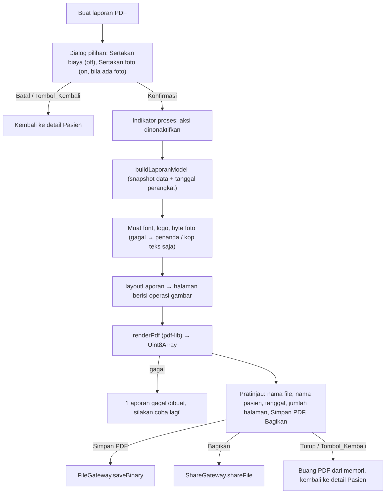

# Design Document: Foto Sesi, Laporan PDF, dan Penyempurnaan Data Pasien

## Overview

Fitur ini memperluas Aplikasi yang dibangun di Spesifikasi_Dasar ("patient-therapy-management") tanpa mengubah arsitektur intinya: SPA React + TypeScript, data lokal di IndexedDB melalui Dexie, satu basis kode untuk PWA dan APK_Android (Capacitor 8). Seluruh tambahan mengikuti prinsip yang sama: logika murni di `src/domain/`, I/O di `src/infra/`, state di `DataStore`, dan UI di `src/ui/`.

Cakupan:

1. Informasi Data_Pasien baca-saja di Formulir_Sesi (Req 1).
2. Foto_Sesi: pilih dari galeri/kamera, konversi dan pengecilan di perangkat, simpan atomik bersama Sesi_Terapi, Penampil_Foto, hapus berantai (Req 2, 3, 4).
3. Laporan_Sesi PDF per satu sesi: susun, pratinjau, simpan, bagikan (Req 5, 6, 8).
4. Halaman_Pengaturan untuk Kop_Laporan termasuk Logo_Praktik (Req 7, 10).
5. Cadangan tetap format versi 1 tanpa foto; impor membersihkan Foto_Sesi yatim (Req 9).
6. Isi nomor HP dari Kontak_Perangkat (Req 11), chat WhatsApp dari nomor HP (Req 12).
7. Label "Diagnosa" (Req 13), atribut Umur dan Jenis_Kelamin (Req 14).

### Keputusan utama

| Keputusan | Pilihan | Alasan |
|---|---|---|
| Format_Foto_Simpan (final) | JPEG kualitas 0,85; PNG bila ada ≥ 1 piksel dengan alpha < 255 | Dua format yang dapat langsung disematkan `pdf-lib` (`embedJpg`/`embedPng`) tanpa transkode ulang, didukung `canvas.toBlob` di semua WebView, dan PNG mempertahankan transparansi (Req 2.22, 10.3) |
| Selalu enkode ulang | Ya, meski sumber sudah JPEG/PNG kecil | Menghapus metadata EXIF (termasuk lokasi GPS foto pasien), menormalkan orientasi ke piksel, dan menyederhanakan alur (glosarium mengizinkan, tidak mewajibkan, menyimpan sumber apa adanya) |
| Dekode HEIC/HEIF | `heic-to` (build WebAssembly libheif), dimuat dinamis | WebView Android dan sebagian besar peramban tidak mendekode HEIC; `heic-to` berjalan sepenuhnya di klien dan mengikuti rilis libheif ([heic-to](https://github.com/hoppergee/heic-to), [libheif-js](https://github.com/catdad-experiments/libheif-js)) |
| Dekode format lain | `createImageBitmap(blob, { imageOrientation: 'from-image' })` | Bawaan peramban; menerapkan orientasi EXIF dan untuk GIF hanya mengambil frame pertama |
| Penyimpanan Foto_Sesi | IndexedDB (tabel `foto` untuk metadata, `fotoData` untuk byte gambar) | Satu transaksi Dexie mencakup sesi + foto sehingga Req 2.12, 4.3, 4.4, 4.7, 9.4, 9.7 terpenuhi tanpa logika kompensasi file; byte gambar dipisah agar `loadAll` tetap ringan |
| Pembuat PDF | `pdf-lib` + `@pdf-lib/fontkit`, font Noto Sans Regular & Bold (TTF, OFL) disematkan dengan `subset: true` | Bekerja offline di peramban; font standar PDF hanya mendukung WinAnsi, sedangkan fontkit memungkinkan font Unicode tersemat ([pdf-lib #1759](https://github.com/Hopding/pdf-lib/issues/1759), [pdf-lib #207](https://github.com/Hopding/pdf-lib/issues/207)) |
| Tata letak PDF | Mesin tata letak murni sendiri (`layoutLaporan`) yang menghasilkan daftar operasi gambar per halaman, lalu dirender `pdf-lib` | Pagination, pembungkusan teks, grid foto, dan "Halaman N dari Total" dapat diuji dengan property-based test tanpa membuka PDF |
| Berbagi file | Android: `@capacitor/share` dengan file di `Directory.Cache`; PWA: Web Share API Level 2 (`navigator.canShare({ files })`) | Plugin Share Capacitor secara bawaan hanya mengizinkan berbagi file dari folder cache ([Share API](https://capacitorjs.com/docs/apis/share)) |
| Pemilih kontak | Android: `@capacitor-community/contacts` (`pickContact`); PWA: Contact Picker API | Plugin menyediakan pemilih bawaan dan alur izin (Req 11.3); Contact Picker API hanya tersedia di sebagian peramban sehingga aksi disembunyikan bila tidak ada (Req 11.2) |
| Membuka WhatsApp | Android: `@capacitor/app-launcher` `openUrl`; PWA: `window.open(url, '_blank', 'noopener')` | `openUrl` menyerahkan URL ke sistem dan menolak bila tidak ada aplikasi penangan (Req 12.5) |
| Pengodean Jenis_Kelamin | String literal `'Laki-laki' \| 'Wanita'`, kosong = `null` | Terbaca langsung di File_Cadangan, tanpa tabel kode; sama dengan teks tampilan |
| Umur kosong | `null` | Membedakan "kosong" dari Umur 0 yang sah |

Temuan riset yang memengaruhi desain:

- libheif dapat dikompilasi ke WebAssembly dan dipakai untuk mendekode HEIC di klien lalu dienkode ulang lewat canvas, tanpa server ([zip-viewer](https://github.com/GeppettoAndRomero/zip-viewer), [dev.to: decoding HEIC with libheif WASM](https://dev.to/muhayminbinmehmood/decoding-iphone-heic-photos-in-the-browser-with-libheif-wasm-and-the-one-line-bug-that-broke-it-242)).
- `pdf-lib` menyematkan seluruh font kecuali opsi `subset: true` diberikan; subset memperkecil ukuran PDF secara signifikan ([pdf-lib #207](https://github.com/Hopding/pdf-lib/issues/207)). Fontkit cukup untuk skrip Latin (termasuk beraksen), yang menjadi cakupan Req 6.7 ([happypdf](https://github.com/seanghay/happypdf)).
- Plugin Share Capacitor hanya dapat berbagi file dari folder cache kecuali `file_paths.xml` diubah ([Share API](https://capacitorjs.com/docs/apis/share)). Karena itu "Bagikan" menulis salinan sementara ke `Directory.Cache`, terpisah dari "Simpan PDF" ke `Documents`.
- Kebijakan Google Play terkait izin kontak sedang diperketat dan mendorong pemakaian pemilih kontak sistem ([Capgo: Google Play Contacts Policy](https://capgo.app/blog/google-play-contacts-permission-policy-capacitor/)). Desain memakai pemilih (bukan membaca seluruh buku kontak), dan versi plugin dikunci serta diverifikasi kompatibel dengan Capacitor 8 saat implementasi.

Content was rephrased for compliance with licensing restrictions.

### Risiko dan asumsi teknis

- **AVIF**: didekode secara bawaan (Chromium ≥ 85; WebView Android diperbarui lewat Play Store). Pada WebView lama yang tidak mendukung, file ditolak dengan alasan "format gambar tidak didukung" (Req 2.6). Ini satu-satunya format di K2 yang bergantung pada versi WebView.
- **Ukuran bundel**: `heic-to` menyertakan modul WASM berukuran beberapa MB. Modul dimuat dinamis hanya saat file HEIC dipilih, tetapi tetap di-precache Workbox agar tersedia offline; `maximumFileSizeToCacheInBytes` dinaikkan (lihat bagian Konfigurasi).
- **Folder Documents Android 11+**: dengan scoped storage, `readdir` mungkin tidak menampilkan file milik instalasi lain. Penentuan akhiran "-N" karena itu juga menangani galat "file sudah ada" saat menulis (lihat Komponen 9).

## Architecture

```mermaid
graph TD
    subgraph UI["Lapisan UI (React)"]
        SesiForm["SesiFormDialog + InfoPasien + FotoPicker"]
        Viewer["PhotoViewer (Penampil_Foto)"]
        Histori["HistoriItem + FotoStrip + aksi Buat laporan PDF"]
        LapFlow["LaporanSesiFlow (dialog pilihan → proses → pratinjau)"]
        Settings["PengaturanPage (+ LogoPicker)"]
        PasienForm["PasienFormDialog (+ Umur, Jenis Kelamin, Ambil dari kontak)"]
        WaLink["NomorWhatsApp (aksi nomor HP)"]
    end

    subgraph State["Lapisan State"]
        Store["DataStore (+ foto meta, pengaturan)"]
    end

    subgraph Domain["Lapisan Domain (fungsi murni)"]
        Val["validator.ts (+ umur, jenisKelamin, pengaturan)"]
        FotoDom["foto.ts (deteksi format, ukuran target, draft foto, alt text)"]
        LapDom["laporanSesi.ts (model, nama file)"]
        Layout["laporanLayout.ts (wrap teks, pagination, grid foto)"]
        Kontak["kontak.ts (Normalisasi_Nomor, isi formulir)"]
        Wa["whatsapp.ts (Nomor_WhatsApp, Tautan_WhatsApp)"]
        Cad["cadangan.ts (+ umur, jenisKelamin)"]
    end

    subgraph Infra["Lapisan Infrastruktur"]
        Repo["Repository (Dexie v2: + foto, fotoData, pengaturan)"]
        ImgProc["ImageProcessor (canvas, heic-to)"]
        Pdf["PdfRenderer (pdf-lib + fontkit)"]
        FileGw["FileGateway (+ saveBinary)"]
        ShareGw["ShareGateway (Web Share / @capacitor/share)"]
        ContactGw["ContactGateway (Contact Picker / plugin kontak)"]
        LinkGw["ExternalLinkGateway (window.open / AppLauncher)"]
        Camera["CameraGateway (input capture)"]
    end

    SesiForm --> FotoDom
    SesiForm --> ImgProc
    SesiForm --> Store
    Settings --> ImgProc
    Settings --> Val
    Settings --> Store
    Histori --> Store
    LapFlow --> LapDom
    LapDom --> Layout
    LapFlow --> Pdf
    LapFlow --> FileGw
    LapFlow --> ShareGw
    PasienForm --> ContactGw
    PasienForm --> Kontak
    WaLink --> Wa
    WaLink --> LinkGw
    Store --> Repo
    Store --> Val
    Store --> Cad
    ImgProc --> FotoDom
```



### Alur simpan Formulir_Sesi dengan foto

```mermaid
sequenceDiagram
    participant U as Pengguna
    participant F as SesiFormDialog
    participant IP as ImageProcessor
    participant S as DataStore
    participant R as Repository (Dexie)

    U->>F: Tambah foto (n file)
    F->>F: dispatch prosesMulai (Simpan & aksi foto nonaktif)
    loop setiap file sesuai urutan pemilihan
        F->>IP: processImage(file, PROFIL_FOTO)
        IP-->>F: FotoDiproses | Penolakan(alasan)
        F->>F: fotoDraftReducer(tambah / tolak / batas 10)
    end
    F->>F: dispatch prosesSelesai
    U->>F: Simpan
    F->>S: simpanSesi(pasienId, sesiId?, input, draft)
    S->>S: validateSesi; cek pasien ada
    S->>R: saveSesiDenganFoto(sesi, {tambah, hapusIds}) — satu transaksi rw [pasien, sesi, foto, fotoData]
    alt transaksi commit
        R-->>S: ok
        S-->>F: ok (memori diperbarui)
    else gagal (kuota penuh, pasien hilang)
        R-->>S: throw (transaksi dibatalkan, tidak ada sisa tulis)
        S-->>F: SaveError / NotFoundError — draft & isian tetap
    end
```

### Alur Laporan_Sesi



### Struktur direktori (tambahan)

```
src/
  domain/   foto.ts, laporanSesi.ts, laporanLayout.ts, kontak.ts, whatsapp.ts, warna.ts
            (diubah: types.ts, validator.ts, format.ts, cadangan.ts)
  infra/    imageProcessor.ts, pdfRenderer.ts, shareGateway.ts, contactGateway.ts,
            externalLink.ts, cameraGateway.ts, fonts/NotoSans-Regular.ttf, fonts/NotoSans-Bold.ttf
            (diubah: db.ts, repository.ts, fileGateway.ts, errors.ts)
  state/    (diubah: dataStore.ts)
  ui/       components/InfoPasien.tsx, FotoStrip.tsx, PhotoViewer.tsx, NomorWhatsApp.tsx
            pages/sesi/FotoPicker.tsx, pages/sesi/LaporanSesiFlow.tsx
            pages/PengaturanPage.tsx (+ LogoPicker.tsx)
            (diubah: SesiFormDialog, HistoriItem, HapusSesiDialog, HapusPasienDialog,
             PasienFormDialog, PasienListPage, PasienDetailPage, JadwalPage,
             JadwalFormDialog, CadanganPage, routes.ts, MainNav.tsx, App.tsx)
```

## Components and Interfaces

### 1. Validator (perluasan `domain/validator.ts`)

```ts
type JenisKelamin = 'Laki-laki' | 'Wanita';

interface PasienInput { nama: string; alamat: string; noHp: string; umur: string; jenisKelamin: '' | JenisKelamin; }
// validatePasien(...) kini mengembalikan PasienFields termasuk umur: number | null, jenisKelamin: JenisKelamin | null

function parseUmur(s: string): { ok: true; value: number | null } | { ok: false };
function validatePengaturan(input: PengaturanInput): ValidationResult<PengaturanFields, 'namaPraktik' | 'alamatPraktik' | 'noHpPraktik'>;
```

| Field | Normalisasi | Aturan | Pesan |
|---|---|---|---|
| umur | `trim()`; `""` → `null` | `/^\d+$/` dan nilai 0–150; nol di depan diizinkan ("035" → 35) | "Umur harus berupa angka 0 sampai 150" |
| jenisKelamin | `""` → `null` | `null`, `'Laki-laki'`, atau `'Wanita'` | (tidak dapat salah dari UI; impor menolak nilai lain) |
| polaPenyakit (label Diagnosa) | sama seperti Spesifikasi_Dasar | ≤ 1000 | "Diagnosa melebihi batas 1000 karakter" (mengganti pesan lama) |
| namaPraktik | `trim()` | wajib, 1–100 | "Nama praktik wajib diisi" / "Nama praktik maksimal 100 karakter" |
| alamatPraktik | `trim()` | ≤ 255 | "Alamat praktik maksimal 255 karakter" |
| noHpPraktik | `trim()` | kosong atau Nomor_HP_Valid | "Nomor HP praktik tidak valid" |

`parseUmur` membandingkan panjang string sebelum konversi agar string angka sangat panjang tidak menimbulkan presisi `Number` yang salah (string > 3 digit setelah nol di depan dibuang langsung ditolak). Semua kesalahan dikumpulkan sekaligus seperti Spesifikasi_Dasar (Req 14.3).

### 2. Format (perluasan `domain/format.ts`)

```ts
function formatUmur(umur: number | null): string;              // 35 → "35 tahun", 0 → "0 tahun", null → "-"
function formatJenisKelamin(jk: JenisKelamin | null): string;  // null → "-"
function atauStrip(s: string): string;                          // whitespace saja → "-" (dipindah dari HistoriItem)
```

### 3. Domain Foto (`domain/foto.ts`)

```ts
export const BATAS_JUMLAH_FOTO = 10;
export const PROFIL_FOTO = { maksByte: 20_971_520, maksSisi: 1600, labelBatas: '20 MB' } as const;
export const PROFIL_LOGO = { maksByte: 5_242_880,  maksSisi: 512,  labelBatas: '5 MB'  } as const;

type FormatSumber = 'jpeg' | 'png' | 'webp' | 'heic' | 'gif' | 'bmp' | 'avif';

/** Deteksi dari magic bytes (12–32 byte pertama), bukan dari MIME/ekstensi yang sering kosong di Android. */
function deteksiFormat(header: Uint8Array): FormatSumber | null;
/** Sisi terpanjang ≤ maks, rasio dipertahankan, tidak diperbesar, sisi minimal 1 px. */
function ukuranTarget(w: number, h: number, maks: number): { w: number; h: number };
function teksAltFoto(n: number, tanggal: string): string;       // "Foto 3 sesi terapi 05 Januari 2025" | "Foto 3 sesi terapi"
function posisiFoto(n: number, total: number): string;          // "3 / 7"
function navPenampil(index: number, total: number): { sebelumnya: boolean; berikutnya: boolean };
```

Aturan `deteksiFormat`: JPEG `FF D8 FF`; PNG `89 50 4E 47 0D 0A 1A 0A`; GIF `"GIF87a"`/`"GIF89a"`; BMP `"BM"`; WebP `"RIFF"....“WEBP”`; ISO-BMFF `"ftyp"` pada offset 4 dengan major/compatible brand `heic, heix, hevc, hevx, heim, heis, mif1, msf1` → `heic`, dan `avif, avis` → `avif` (AVIF diperiksa lebih dulu karena berkas AVIF juga dapat memuat brand `mif1`).

`ukuranTarget`: jika `max(w,h) ≤ maks` kembalikan `{w,h}`; selain itu sisi terpanjang = `maks`, sisi terpendek = `max(1, round(sisiPendek × maks / sisiPanjang))`. Ini menjamin selisih pembulatan ≤ 1 px (Req 2.3, 10.2).

#### Draft foto Formulir_Sesi (state murni)

```ts
type ItemDraft =
  | { jenis: 'tersimpan'; meta: FotoMeta }                                   // sudah ada di Penyimpanan_Data
  | { jenis: 'baru'; tempId: string; foto: FotoDiproses };                  // hasil ImageProcessor, belum disimpan

interface FotoDraft { items: ItemDraft[]; memproses: boolean; pesan: string[] }

type AksiDraft =
  | { type: 'prosesMulai' }
  | { type: 'terima'; tempId: string; foto: FotoDiproses }
  | { type: 'tolak'; namaFile: string; alasan: AlasanTolak }
  | { type: 'prosesSelesai' }
  | { type: 'hapus'; key: string };

function draftAwal(fotoTersimpan: FotoMeta[]): FotoDraft;                   // urut `urutan` naik
function fotoDraftReducer(s: FotoDraft, a: AksiDraft): FotoDraft;
function bolehTambah(s: FotoDraft): boolean;                                // !memproses && items.length < 10
function diffDraft(awal: FotoMeta[], s: FotoDraft): { tambah: FotoDiproses[]; hapusIds: string[] };
function pesanPenolakan(namaFile: string, alasan: AlasanTolak): string;
```

- `terima` saat `items.length === 10` diubah menjadi penolakan dengan pesan "Maksimal 10 foto per sesi terapi" (pesan ini dicatat sekali per pemilihan). Karena file diproses berurutan sesuai urutan pemilihan, gambar valid diterima sampai batas lalu sisanya ditolak (Req 2.8). FotoPicker juga berhenti memproses file berikutnya begitu batas tercapai agar tidak membuang waktu.
- `AlasanTolak = 'format' | 'ukuran' | 'batas'`. Pesan: `"{nama}: format gambar tidak didukung"`, `"{nama}: ukuran melebihi batas 20 MB"`, dan "Maksimal 10 foto per sesi terapi".
- Batal/Tombol_Kembali cukup membuang draft; tidak ada yang ditulis sebelum Simpan (Req 2.14). Kegagalan validasi/simpan tidak menyentuh draft (Req 2.15).

### 4. ImageProcessor (`infra/imageProcessor.ts`)

```ts
interface FotoDiproses { data: ArrayBuffer; mime: 'image/jpeg' | 'image/png'; ukuran: number; lebar: number; tinggi: number; }
type HasilProses = { ok: true; foto: FotoDiproses } | { ok: false; alasan: 'format' | 'ukuran' };

interface ImageProcessor {
  process(file: File, profil: typeof PROFIL_FOTO | typeof PROFIL_LOGO): Promise<HasilProses>;
}
```

Langkah `process`:

1. `file.size > profil.maksByte` → `{ ok: false, alasan: 'ukuran' }` tanpa membaca isi (Req 2.7, 10.8).
2. Baca 32 byte pertama → `deteksiFormat`; `null` → `'format'`.
3. Dekode menjadi `ImageBitmap`:
   - `heic`: `import('heic-to')` lalu `heicTo({ blob: file, type: 'image/png' })`, kemudian `createImageBitmap(png)`. libheif menerapkan transformasi rotasi/mirror HEIF sehingga orientasi tampilan sama dengan galeri.
   - lainnya: `createImageBitmap(file, { imageOrientation: 'from-image' })`. Untuk GIF hanya frame pertama yang didekode (Req 2.21).
   - Galat dekode apa pun → `'format'` (Req 2.6).
4. `ukuranTarget(bitmap.width, bitmap.height, profil.maksSisi)`; gambar ke canvas dengan `imageSmoothingQuality = 'high'`. Untuk pengecilan > 2× dilakukan bertahap (setengah per langkah) agar hasil tidak bergerigi.
5. Deteksi transparansi: untuk format yang dapat memiliki alpha (png, webp, gif, avif, heic, bmp) pindai `getImageData` dan cek ada alpha < 255. Ada → PNG, tidak ada → JPEG 0,85 (Req 2.22, 10.3). JPEG sumber tidak dipindai.
6. `canvas.toBlob(mime)`; `null` → `'format'`. Kembalikan byte, mime, ukuran, lebar/tinggi akhir.

Seluruh langkah berjalan di perangkat; tidak ada permintaan jaringan (Req 2.17, 2.23, 10.14). Batas waktu 3 dtk / 5 dtk (HEIC) adalah target kinerja yang diverifikasi di uji E2E, bukan timeout yang menolak gambar; sebagai pengaman, proses yang tidak selesai dalam 30 detik dianggap gagal dengan alasan `'format'` agar indikator proses tidak tertahan selamanya.

### 5. CameraGateway dan FotoPicker

- "Tambah foto": `<input type="file" accept="image/*,.heic,.heif,.avif" multiple>`. Pembatalan dideteksi lewat event `cancel` atau `change` tanpa file → tidak ada perubahan dan tidak ada pesan (Req 2.18). Pola ini sama dengan `pickTextFileViaInput` yang ada.
- "Ambil foto": `<input type="file" accept="image/*" capture="environment">` (satu foto). Tombol hanya ditampilkan bila `navigator.mediaDevices?.enumerateDevices()` melaporkan `videoinput`, atau pada APK_Android (Req 2.2). Pada APK_Android izin `CAMERA` dideklarasikan di `AndroidManifest.xml`; WebChromeClient Capacitor meneruskan `capture` ke aplikasi kamera. Kegagalan membuka kamera (galat/izin ditolak terdeteksi oleh tidak adanya event `change` setelah fokus kembali bukanlah galat; galat eksplisit hanya dari promise izin) menampilkan "Kamera tidak dapat digunakan. Gunakan Tambah foto dari galeri." (Req 2.19).
- Selama `draft.memproses`, tombol Simpan, "Tambah foto", dan "Ambil foto" `disabled` dan indikator `role="status"` "Memproses foto…" tampil (Req 2.16). `bolehTambah` juga menonaktifkan kedua aksi saat jumlah = 10 (Req 2.9).

### 6. InfoPasien dan Formulir_Sesi

`InfoPasien` merender `<dl>` (bukan `<input>`) dengan label "Nama", "Umur", "Jenis Kelamin", "Alamat", "Nomor HP" dan nilai dari snapshot Data_Pasien saat dialog dibuka; nilai kosong → "-" (Req 1.1, 1.2). CSS `overflow-wrap: anywhere; white-space: pre-wrap` menjamin teks panjang tidak terpotong pada lebar ≥ 320 px (Req 1.5). Elemen tidak memiliki `tabindex` sehingga tidak dapat difokuskan sebagai isian.

`SesiFormDialog` diubah:

- Saat dibuka, `store.selectPasien(pasienId)`; bila `undefined`, dialog hanya menampilkan "Data pasien tidak ditemukan" dan tombol Tutup (Req 1.4).
- Urutan: InfoPasien → tanggal → keluhan → Diagnosa → terapi → hasil → biaya → FotoPicker + Thumbnail.
- Label "Diagnosa" dengan `id`/`htmlFor` sehingga nama aksesibel = "Diagnosa" (Req 13.1).
- Simpan memanggil `store.simpanSesi(...)`. `NotFoundError('pasien')` → pesan "Data pasien tidak ditemukan" dan tidak ada yang tersimpan (Req 1.6).

### 7. Penampil_Foto dan Thumbnail

```ts
interface FotoSource { key: string; load(): Promise<Blob>; }   // tersimpan: repo.loadFotoData; baru: Blob dari FotoDiproses
interface PhotoViewerProps { sources: FotoSource[]; startIndex: number; tanggal: string; onClose(lastIndex: number): void; }
```

- Thumbnail (`FotoStrip`) memakai `URL.createObjectURL` dari Blob, `loading="lazy"`, `decoding="async"`, dan URL dicabut saat unmount. Kegagalan memuat (rekaman `fotoData` hilang atau dekode `` gagal / event `error`) menampilkan penanda "Foto tidak dapat dimuat" tanpa mengubah data (Req 3.7).
- Histori menampilkan strip thumbnail dan teks "N foto" hanya bila N ≥ 1 (Req 3.1, 3.2). Metadata berasal dari `DataStore`, sehingga jumlah dan urutan selalu tersedia walau byte gagal dimuat.
- `PhotoViewer` adalah `Dialog` layar penuh yang terdaftar di `DialogStack` sehingga Tombol_Kembali, tombol tutup, dan Escape menutupnya (Req 3.5). Gambar memakai `object-fit: contain; width: 100%; height: 100%` sehingga foto utuh dan menyentuh lebar atau tinggi area (Req 3.3). Posisi `posisiFoto(n, total)`, tombol sebelumnya/berikutnya mengikuti `navPenampil` (Req 3.4, 3.8, 3.9). Saat ditutup, fokus dipindah ke thumbnail indeks terakhir (Req 3.5).
- Foto berikutnya/sebelumnya di-prefetch saat foto ditampilkan agar navigasi < 1 detik.

### 8. Domain Laporan_Sesi (`domain/laporanSesi.ts`)

```ts
interface OpsiLaporan { sertakanBiaya: boolean; sertakanFoto: boolean; }

interface LaporanModel {
  kop: { namaPraktik: string; alamat: string | null; noHp: string | null; adaLogo: boolean };
  judul: 'Laporan Hasil Terapi';
  bagian: Array<{ judul: 'Data Pasien' | 'Sesi Terapi'; baris: Array<{ label: string; nilai: string }> }>;
  foto: FotoMeta[] | null;        // null → tanpa bagian "Dokumentasi Foto"
  tanggalDibuat: string;          // "DD MMMM YYYY"
  namaFile: string;
  judulBagikan: string;           // "Laporan Hasil Terapi - {nama}"
}

function opsiAwal(jumlahFoto: number): { opsi: OpsiLaporan; tampilkanOpsiFoto: boolean };
function buildLaporanModel(p: Pasien, s: SesiTerapi, foto: FotoMeta[], peng: PengaturanLaporan | null, opsi: OpsiLaporan, now: Date): LaporanModel;
function slugNama(nama: string): string;                          // lowercase, [^a-z0-9]+ → "-", trim "-", ≤ 40, kosong → "pasien"
function namaFileLaporan(nama: string, tanggal: ISODate): string; // "laporan-terapi-{slug}-YYYYMMDD.pdf"
function namaFileUnik(dasar: string, terpakai: ReadonlySet<string>): string; // dasar, atau "{stem}-N.pdf" dengan N terkecil ≥ 2
```

Isi bagian (Req 5.3, 5.4, 5.7, 13.3):

- Data Pasien: Nama, Umur (`formatUmur`), Jenis Kelamin, Alamat, Nomor HP.
- Sesi Terapi: Tanggal terapi (`formatTanggal`), Keluhan, Diagnosa, Terapi yang diberikan, Hasil terapi, lalu Biaya (`formatRupiah`) sebagai baris terakhir hanya bila `sertakanBiaya`.
- Nilai kosong → "-". Nilai lain disalin apa adanya (Req 5.6).
- Kop: Nama_Praktik dari pengaturan bila tidak kosong, selain itu "Data Pasien" tanpa logo/alamat/HP (Req 6.8). Alamat dan HP hanya bila terisi.
- `slugNama` memotong 40 karakter lalu membuang "-" di ujung lagi agar hasil tidak berakhir dengan "-".

`buildLaporanModel` memotret data pada saat dimulai (Req 5.6, 5.9); perubahan data setelahnya tidak memengaruhi PDF yang sedang disusun.

### 9. Tata letak PDF (`domain/laporanLayout.ts`)

Fungsi murni yang tidak bergantung pada `pdf-lib`. Ukuran teks diukur melalui antarmuka yang disuntikkan:

```ts
interface FontMetrics {
  widthOf(text: string, font: 'regular' | 'bold', sizePt: number): number;
  hasGlyph(codePoint: number, font: 'regular' | 'bold'): boolean;
}
interface GambarInfo { key: string; lebarPx: number; tinggiPx: number; gagal: boolean; }

type Op =
  | { t: 'text'; x: number; y: number; text: string; font: 'regular' | 'bold'; size: number; color: Rgb }
  | { t: 'rect'; x: number; y: number; w: number; h: number; color: Rgb }
  | { t: 'image'; key: string; x: number; y: number; w: number; h: number }
  | { t: 'placeholder'; x: number; y: number; w: number; h: number; text: 'Foto tidak dapat dimuat' };

interface Halaman { ops: Op[] }

function gantiGlyphTakDidukung(text: string, font: 'regular' | 'bold', m: FontMetrics): string; // tiap code point tanpa glyph → "?"
function bungkusTeks(text: string, lebarMaks: number, font: 'regular' | 'bold', size: number, m: FontMetrics): string[];
function layoutLaporan(model: LaporanModel, m: FontMetrics, logo: GambarInfo | null, foto: GambarInfo[]): Halaman[];
```

Konstanta (satuan pt; 1 mm = 2,8346 pt):

| Konstanta | Nilai |
|---|---|
| Halaman | A4 tegak 595,28 × 841,89 |
| Margin | 18 mm (51,02 pt) di setiap sisi (≥ 15 mm, Req 6.1) |
| Nama_Praktik | Bold 18 pt (terbesar di halaman, Req 6.2) |
| Judul laporan | Bold 15 pt |
| Judul bagian | Bold 13 pt di atas blok aksen muda (Req 6.3) |
| Label / nilai | Bold 10,5 pt / Regular 10,5 pt (≥ 10 pt, Req 6.9) |
| Footer | Regular 8,5 pt (≥ 8 pt) |
| Kolom label | lebar 120 pt; kolom nilai mulai di `margin + 128` (Req 6.4) |
| Tinggi baris | 1,4 × ukuran huruf |
| Area footer | 20 pt terakhir di atas margin bawah; isi tidak boleh masuk area ini |
| Logo | maksimal 60 mm × 25 mm, rasio dipertahankan; Nama_Praktik mulai di `margin + lebarLogo + 4 mm` (Req 10.11) |
| Foto | grid 2 kolom, jarak 6 mm; tiap foto muat dalam `lebarKolom × (tinggiIsi / 2)`; tidak diperbesar melebihi ukuran asli (1 px = 0,75 pt) |

Aturan tata letak:

1. **Pembungkusan teks** (`bungkusTeks`): teks dipecah pada `\n`; tiap paragraf dibungkus per kata pada spasi; kata yang lebih lebar dari `lebarMaks` dipecah per code point. Paragraf kosong menghasilkan satu baris kosong. Penggabungan kembali baris-baris memulihkan teks semula (spasi pemisah pada titik bungkus dikonsumsi).
2. **Pagination per baris**: penempatan dilakukan baris demi baris; bila baris berikutnya tidak muat di atas area footer, halaman baru dimulai. Tidak ada baris yang terbelah atau keluar margin (Req 5.10). Baris lanjutan nilai tetap di kolom nilai (Req 6.4).
3. **Kop** hanya di halaman 1: logo (bila tersedia dan tidak gagal) di kiri, Nama_Praktik/alamat/HP dibungkus ke lebar sisa (Req 6.10); diakhiri garis aksen setebal 2 pt selebar area isi. Logo gagal dimuat → kop teks saja mulai di margin kiri (Req 10.12, 10.13).
4. **Grid foto**: urutan kiri ke kanan lalu baris berikutnya; foto ganjil terakhir di kolom kiri; satu baris foto pindah ke halaman baru bila tidak muat utuh (Req 6.6). Judul "Dokumentasi Foto" tidak dibiarkan sendirian di akhir halaman (ditempatkan bersama baris foto pertama). Foto gagal → `placeholder` berukuran sel dengan teks "Foto tidak dapat dimuat" (Req 5.16).
5. **Footer** setiap halaman: kiri "Dibuat {tanggalDibuat}", kanan "Halaman N dari Total". Total diketahui karena footer ditambahkan setelah seluruh halaman tersusun (Req 5.9).
6. **Karakter tak didukung**: semua teks melewati `gantiGlyphTakDidukung` sebelum diukur dan digambar; karakter pengganti tunggal adalah "?" (U+003F) yang pasti ada di Noto Sans (Req 6.11). Sepasang surrogate dihitung sebagai satu code point sehingga satu emoji menjadi satu "?".

Palet warna (`domain/warna.ts`, diverifikasi dengan fungsi `rasioKontras` WCAG):

| Pemakaian | Teks | Latar | Rasio |
|---|---|---|---|
| Isi, label, kop | `#1F2937` | `#FFFFFF` | ≈ 14,7 : 1 |
| Judul bagian | `#134E4A` | blok aksen `#E6F4F1` | ≈ 8,7 : 1 |
| Footer | `#4B5563` | `#FFFFFF` | ≈ 7,6 : 1 |
| Garis aksen kop | — | `#0F766E` | (bukan teks) |

Semua pasangan ≥ 4,5 : 1 (Req 6.5); uji memeriksa setiap pasangan teks/latar yang dipakai layout.

### 10. PdfRenderer (`infra/pdfRenderer.ts`)

```ts
interface PdfRenderer {
  metrics(): Promise<FontMetrics>;                                   // dari font Noto Sans yang dimuat
  render(halaman: Halaman[], gambar: Map<string, { data: ArrayBuffer; mime: string }>): Promise<Uint8Array>;
}
```

- `pdf-lib` dan `@pdf-lib/fontkit` dimuat dinamis (`import()`) saat laporan pertama dibuat, lalu di-cache di memori.
- Font TTF di-bundel sebagai aset Vite (`?url`) dan di-precache Workbox (tambahkan `ttf` ke `globPatterns`), sehingga tersedia offline (Req 5.11).
- `doc.registerFontkit(fontkit)`; `embedFont(bytes, { subset: true })` untuk Regular dan Bold (Req 6.7).
- `hasGlyph` memakai `font.embedder.font.hasGlyphForCodePoint(cp)` dari fontkit (dibungkus agar mudah diganti).
- Foto JPEG → `embedJpg`, PNG → `embedPng`. Setiap gambar disematkan sekali.
- Metadata PDF: `setTitle(judulBagikan)`, `setCreator('Data Pasien')`, `setProducer('Data Pasien')`.

`LaporanSesiFlow` memanggil berurutan: `buildLaporanModel` → muat byte logo & foto (galat per gambar ditandai `gagal`) → baca dimensi dari `FotoMeta`/logo meta → `layoutLaporan` → `render`. Galat di luar pemuatan gambar → "Laporan gagal dibuat, silakan coba lagi", dialog ditutup, tidak ada file yang dibuat (Req 5.13). Tombol konfirmasi dan "Buat laporan PDF" dinonaktifkan dengan flag `menyusun` sejak klik pertama (Req 5.15).

### 11. FileGateway dan ShareGateway

```ts
interface FileGateway {
  saveText(fileName: string, content: string): Promise<{ location: string }>;       // tetap
  pickTextFile(): Promise<string | null>;                                           // tetap
  saveBinary(fileName: string, data: Uint8Array, mime: string): Promise<{ fileName: string; location: string }>;
}

interface ShareGateway {
  canShareFile(mime: string): Promise<boolean>;
  /** 'dibagikan' | 'dibatalkan'; melempar ShareError untuk kegagalan lain. */
  shareFile(fileName: string, data: Uint8Array, mime: string, title: string): Promise<'dibagikan' | 'dibatalkan'>;
}
```

**Web `saveBinary`**: Blob + `<a download>` seperti `saveText`; `fileName` tidak diubah; pratinjau tetap terbuka (Req 8.4).

**Android `saveBinary`** (Req 8.5, 8.6, 8.10):

1. `Filesystem.readdir({ directory: Documents, path: '' })` → himpunan nama (galat `readdir` diperlakukan sebagai himpunan kosong).
2. `nama = namaFileUnik(fileName, terpakai)`.
3. `Filesystem.writeFile({ path: nama, data: base64, directory: Documents })` **tanpa** `recursive` menimpa? `writeFile` Capacitor menimpa file yang ada; karena itu sebelum menulis dipanggil `Filesystem.stat` pada nama kandidat. Bila `stat` berhasil (file ada walau tidak terlihat di `readdir`), nama ditambahkan ke `terpakai` dan langkah 2 diulang (maksimal 1000 kali).
4. Bila `writeFile` gagal, `Filesystem.deleteFile` pada nama tersebut dicoba (galat diabaikan) agar tidak tersisa file tidak lengkap, lalu `SaveFileError` dilempar.
5. Pada Android ≤ 9, `Filesystem.requestPermissions()` dipanggil sebelum menulis; penolakan → `SaveFileError('izin')`.

**Web `ShareGateway`**: `canShareFile` = `navigator.canShare?.({ files: [new File([], 'x.pdf', { type: mime })] }) === true`. `shareFile` memanggil `navigator.share({ files: [file], title })`; `AbortError` → `'dibatalkan'` (Req 8.9).

**Android `ShareGateway`**: tulis salinan ke `Directory.Cache` (`laporan/<fileName>`, menimpa salinan lama), lalu `Share.share({ title, dialogTitle: title, files: [uri] })`. Galat dengan pesan pembatalan (`"Share canceled"`) → `'dibatalkan'`. `canShareFile` = `Share.canShare()`. Folder `laporan/` di cache dikosongkan saat pratinjau ditutup (Req 8.13).

Bila `canShareFile` false, tombol "Bagikan" `disabled` dan keterangan "Perangkat ini tidak mendukung berbagi file. Simpan PDF lalu kirim secara manual." tampil (Req 8.8). Selama simpan/bagikan, kedua tombol dinonaktifkan (Req 8.12).

### 12. Pengaturan (`ui/pages/PengaturanPage.tsx`)

- Rute baru `/pengaturan`. `MAIN_NAV` menjadi empat menu: Pasien, Jadwal, Laporan, Pengaturan; ikon Cadangan tetap terpisah (Req 7.8, 7.9). Pada lebar 360 px setiap menu tetap ≥ 44 × 44 px.
- Formulir diisi dari `store.selectPengaturan()` atau bawaan `{ namaPraktik: 'Data Pasien', alamatPraktik: '', noHpPraktik: '', logo: null }` (Req 7.5).
- State lokal `draftLogo: { jenis: 'tetap' } | { jenis: 'baru'; foto: FotoDiproses } | { jenis: 'hapus' }`. "Pilih logo"/"Ganti logo" memakai `ImageProcessor.process(file, PROFIL_LOGO)`; penolakan mempertahankan pratinjau sebelumnya (Req 10.5–10.8). Selama memproses, Simpan dan aksi logo dinonaktifkan (Req 10.15).
- Simpan: `validatePengaturan` → `store.simpanPengaturan(fields, draftLogo)` → satu `put` rekaman tunggal (atomik, Req 7.10, 10.9). Berhasil → "Pengaturan berhasil disimpan". Gagal → "Pengaturan gagal disimpan", isian tetap (Req 7.7).
- Batal: mengembalikan isian dan draft logo ke nilai tersimpan. Berpindah halaman atau Tombol_Kembali membuang draft karena state lokal di-unmount (Req 7.6, 10.10).
- Pratinjau logo: `` dengan `object-fit: contain` (Req 10.4).

Karena `DataStore` menyimpan pengaturan di memori dan memperbaruinya setelah commit, laporan berikutnya langsung memakai nilai terbaru (Req 7.4).

### 13. Kontak (`domain/kontak.ts` + `infra/contactGateway.ts`)

```ts
function normalisasiNomor(s: string): string;   // hapus /[\s\-.()]/g; karakter lain dipertahankan
function terapkanKontak(form: { nama: string; noHp: string }, kontak: { nama: string }, nomor: string): { nama: string; noHp: string };
// noHp = normalisasiNomor(nomor); nama diisi trim(kontak.nama) dipotong 100 code point hanya bila form.nama.trim() === '' dan nama kontak tidak kosong

interface KontakTerpilih { nama: string; nomor: string[] }
interface ContactGateway {
  tersedia(): boolean;
  /** null jika dibatalkan; melempar ContactError bila izin ditolak atau galat sistem. */
  pilih(): Promise<KontakTerpilih | null>;
}
```

- Android: `@capacitor-community/contacts` — `requestPermissions()` lalu `pickContact({ projection: { name: true, phones: true } })`. Hanya kontak terpilih yang dibaca; tidak ada yang disimpan (Req 11.12). Izin `READ_CONTACTS` dideklarasikan di manifest.
- PWA: `tersedia()` = `'contacts' in navigator && 'select' in navigator.contacts`; `navigator.contacts.select(['name', 'tel'], { multiple: false })`; array kosong → `null`.
- Alur UI di `PasienFormDialog`: 0 nomor → "Kontak ini tidak memiliki nomor telepon" (Req 11.15); 1 nomor → langsung `terapkanKontak`; ≥ 2 → dialog daftar nomor (terdaftar di DialogStack) sesuai urutan, menutupnya tanpa memilih tidak mengubah apa pun (Req 11.5, 11.10, 11.14). Galat → "Kontak tidak dapat diakses. Nomor HP dapat diisi manual." (Req 11.11). Tidak ada validasi saat mengisi; validasi biasa berjalan saat dikirim (Req 11.9).

### 14. WhatsApp (`domain/whatsapp.ts` + `infra/externalLink.ts` + `ui/components/NomorWhatsApp.tsx`)

```ts
function nomorWhatsApp(noHp: string): string;   // "+62…" → "62…", "0…" → "62…", "62…" tetap
function tautanWhatsApp(noHp: string): string;  // `https://wa.me/${nomorWhatsApp(noHp)}`

interface ExternalLinkGateway { open(url: string): Promise<boolean>; }  // false bila sistem tidak dapat membuka
```

- Android: `AppLauncher.openUrl({ url })`; galat atau `completed: false` → `false`. PWA: `window.open(url, '_blank', 'noopener,noreferrer')`; `null` → `false`.
- `NomorWhatsApp` adalah `<button type="button">` dengan teks = nomor HP tersimpan apa adanya dan `aria-label="Chat WhatsApp {nama}"` (Req 12.1). `onClick` memanggil `event.stopPropagation()` dan `preventDefault()` sehingga baris daftar, kartu jadwal, atau formulir tidak ikut bereaksi (Req 12.4, 12.12, 12.13). `false` → toast "WhatsApp tidak dapat dibuka. Nomor HP: {noHp}" (Req 12.5).
- Daftar pasien: baris disusun sebagai kontainer dengan tautan nama (ke detail) dan tombol nomor sebagai elemen saudara, bukan tombol di dalam `<a>` (HTML tidak mengizinkan elemen interaktif bersarang).
- Halaman_Jadwal: tombol nomor ditampilkan untuk semua status; disembunyikan bila pasien tidak ditemukan (Req 12.8, 12.14).
- Formulir_Jadwal: tombol di bawah isian "Pasien" hanya bila pasien terpilih; diturunkan langsung dari nilai `pasienId` saat render sehingga selalu sinkron saat pilihan berganti (Req 12.9–12.11).

### 15. Repository (perluasan `infra/repository.ts`)

```ts
interface Repository {
  // … metode Spesifikasi_Dasar tetap …
  loadAll(): Promise<AppData & { foto: FotoMeta[]; pengaturan: PengaturanLaporan | null }>;
  /** Satu transaksi rw [pasien, sesi, foto, fotoData]; NotFoundError('pasien') bila pasien tidak ada. */
  saveSesiDenganFoto(sesi: SesiTerapi, mode: 'tambah' | 'ubah', perubahan: { tambah: FotoBaru[]; hapusIds: string[] }): Promise<FotoMeta[]>;
  deleteSesi(id: string): Promise<void>;                 // + hapus foto & fotoData milik sesi
  deletePasienCascade(id: string): Promise<void>;        // + hapus foto & fotoData milik seluruh sesi pasien
  replaceAll(data: AppData): Promise<void>;              // + hapus foto yang sesiId-nya tidak ada di data
  loadFotoData(fotoId: string): Promise<ArrayBuffer>;    // NotFoundError('foto') bila hilang
  savePengaturan(p: PengaturanLaporan): Promise<void>;
  loadLogoData(): Promise<ArrayBuffer | null>;
}
```

- `saveSesiDenganFoto`: di dalam transaksi, cek `pasien.get(sesi.pasienId)`; `add`/`updateExisting` sesi; `bulkDelete` hapusIds dari `foto` dan `fotoData` (hanya id yang memang milik sesi ini); untuk foto baru beri `id = newId()`, `urutan = maks(urutan tersisa) + 1 + i`, `ditambahkanPada = now`; `bulkAdd` ke `foto` dan `fotoData`. Urutan relatif foto yang dipertahankan tidak berubah (Req 2.13). Kuota penuh membatalkan seluruh transaksi sehingga tidak ada data gambar tersisa (Req 4.7).
- `replaceAll`: dalam satu transaksi enam tabel (tanpa `pengaturan`), kumpulkan `sesiId` baru, hapus `foto`/`fotoData` yang `sesiId`-nya tidak termasuk, sisanya dipertahankan apa adanya (Req 9.4, 9.5, 9.6, 9.7).
- `deleteSesi` dan `deletePasienCascade` menyertakan tabel `foto`/`fotoData` dalam transaksi yang sama (Req 4.3, 4.4, 4.10).

### 16. DataStore (perluasan `state/dataStore.ts`)

State memori bertambah `foto: FotoMeta[]` dan `pengaturan: PengaturanLaporan | null` (tanpa byte gambar). Aksi dan selector baru:

```ts
simpanSesi(pasienId: string, sesiId: string | null, input: SesiInput, draft: FotoDraft): Promise<ActionResult<SesiTerapi, SesiField>>;
simpanPengaturan(input: PengaturanInput, logo: DraftLogo): Promise<ActionResult<PengaturanLaporan, PengaturanField>>;
selectFotoSesi(sesiId: string): FotoMeta[];            // urut `urutan` naik
selectJumlahFotoPasien(pasienId: string): number;      // untuk dialog hapus pasien (Req 4.6)
selectPengaturan(): PengaturanLaporan | null;
loadFotoBlob(meta: FotoMeta): Promise<Blob>;
```

`addSesi`/`updateSesi` lama dipertahankan sebagai pembungkus `simpanSesi` dengan draft kosong agar pemanggil dan uji lama tetap berlaku. `selectDeletionSummary` ditambah `jumlahFoto`. Pesan dialog: "… beserta N foto" untuk sesi bila N ≥ 1 (Req 4.5), dan "… N foto" (termasuk 0) untuk pasien (Req 4.6).

### 17. Cadangan (perluasan `domain/cadangan.ts`)

- `pickPasien`/`serializeBackup` selalu menulis `umur` dan `jenisKelamin` (nilai `null` bila kosong); `formatVersion` tetap 1 (Req 9.11).
- `parsePasien`: atribut tidak ada atau `null` → `null` (Req 9.12). `umur` terisi harus `Number.isInteger` dan 0–150, `jenisKelamin` terisi harus `'Laki-laki'`/`'Wanita'`; selain itu ditolak dengan alasan "Atribut umur tidak valid" atau "Atribut jenisKelamin tidak valid" (Req 9.13).
- Nama atribut `polaPenyakit` tidak berubah (Req 9.14, 13.6).
- Pesan ekspor berhasil dan dialog konfirmasi impor ditambah kalimat "Foto sesi terapi tidak disertakan dalam file cadangan." (Req 9.2, 9.3).
- Foto dan pengaturan tidak pernah diserialisasi (Req 9.1).

### 18. Konfigurasi

- Dependensi baru (versi dikunci tepat saat implementasi): `pdf-lib`, `@pdf-lib/fontkit`, `heic-to`, `@capacitor/share`, `@capacitor/app-launcher`, `@capacitor-community/contacts` (verifikasi dukungan Capacitor 8; bila belum ada, buat plugin lokal kecil di `android/` yang memakai `Intent.ACTION_PICK` + `ContactsContract`, dengan antarmuka `ContactGateway` yang sama).
- `vite.config.ts`: `globPatterns` ditambah `ttf` dan `wasm`; `maximumFileSizeToCacheInBytes: 8 * 1024 * 1024`.
- `AndroidManifest.xml`: `CAMERA`, `READ_CONTACTS`, `<queries>` untuk intent `VIEW` skema `https` (Android 11+ package visibility agar `openUrl` dapat menemukan WhatsApp/peramban).
- Font Noto Sans (SIL Open Font License) disertakan beserta berkas lisensinya di `src/infra/fonts/`.
